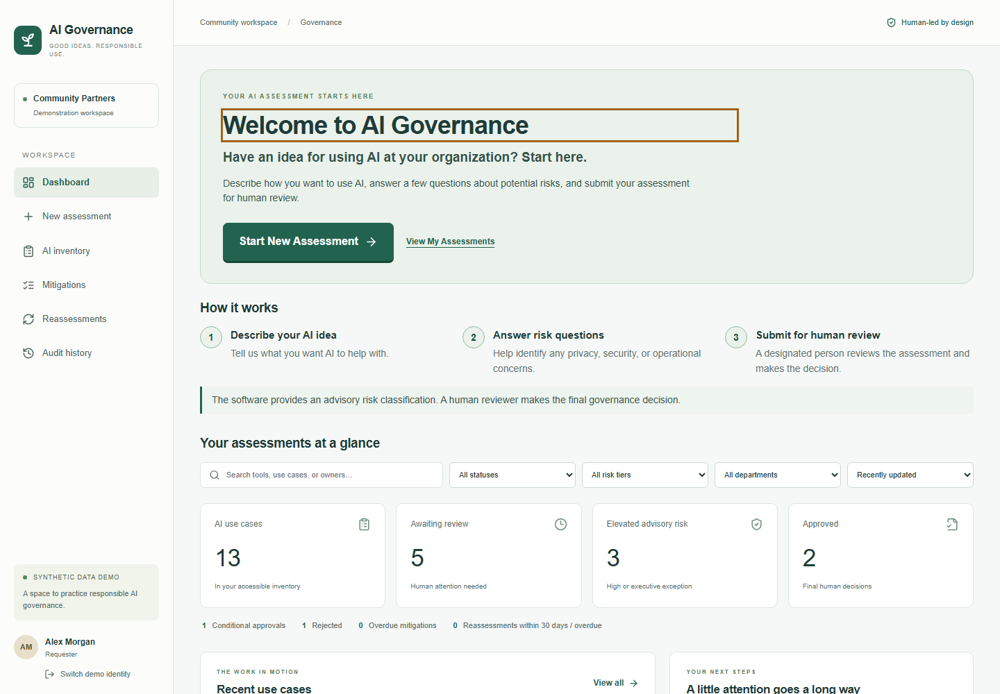
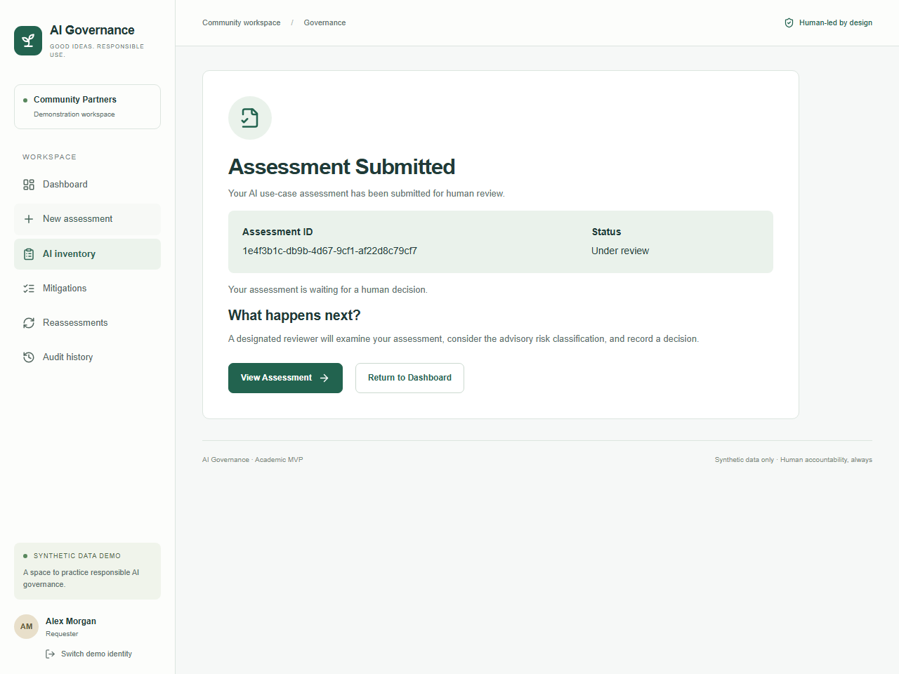

# UAT-driven user experience improvements

**Implementation branch:** `feature/uat-requester-ux`  
**Target branch:** `feature/php-mysql-version`  
**Related work:** [Issue #6](https://github.com/ctucker-web/ai-governance-capstone/issues/6)

**Verification status:** the interface changes are implemented and the local checks reported below passed. Eight actual application screenshots are included. No follow-up human UAT results are claimed, and this build has not been deployed to the public demonstration.

## Original evidence and interpretation

The unchanged [Unit 7 findings](../testing/UNIT7_HUMAN_UAT_FINDINGS.md) describe six live human UAT sessions. Several Requesters did not readily discover where to begin. Participants with more experience navigated more comfortably; less-experienced participants sought direction and expressed uncertainty. This suggests a discoverability and confidence problem. It does not establish that age causes difficulty or that the risk algorithm is wrong.

Only five quick ratings were supplied: **2, 3, 3, 3, 3**. Their participant/question mapping and the sixth value are unavailable. These are incomplete feedback data, not a validated six-person mean, System Usability Scale score, or task-success measurement. The supplied reference instrument was blank; completed participant worksheets and timings are unavailable. The original findings remain unchanged.

The design objective is for a first-time Requester to identify where to start, what information is needed, and what happens after submission in approximately five seconds. That is a target for the next study, not a measured improvement.

## Audit of the existing interface

The PHP frontend entry point, `versions/php-mysql/frontend/main.tsx`, loads the existing shared React components. The PHP build compiles these components and the existing stylesheet to static browser assets; it does not run Next.js on the host. Existing form fields, cards, buttons, status badges, icons, tables, filters, and responsive rules can be reused without a new framework.

The original Requester dashboard placed inventory filters before the welcome area. A generic dashboard heading, a separate "New assessment" button, and the less explicit "Bring an idea forward" link competed to explain the next action. The welcome illustration conveyed a theme but did not describe the actual intake steps. Empty inventory copy assumed users understood use cases and filters.

The three-step intake retained values in component state but used broad validation summaries at final save. Step progression relied partly on native field validation; explanatory errors were not consistently associated with each field. It lacked a final intake summary, explicit completed/current/remaining step semantics, and a guard against leaving unsaved work. A successful submission returned to record details with a short notice, rather than a prominent confirmation containing the persisted identifier and next step.

The existing review queue, backend role checks, eight-factor risk scoring, evidence/mitigation workflow, policy versions, and audit records already supported the governance lifecycle. The change focuses on making those capabilities understandable and discoverable.

## Screens and implemented changes

The existing light visual system is retained. The changes below have been inspected in source; their executed verification is recorded separately.

| Screen | Implemented improvement | Source |
| --- | --- | --- |
| Requester dashboard | A single dominant **Start New Assessment** action in the top welcome panel, concise task description, **View My Assessments**, and a helpful first-assessment empty state. Inventory filters and reporting follow the introductory guidance. | `src/components/governance-app.tsx` |
| Dashboard process guide | An ordered three-stage explanation: describe the AI idea, answer risk questions, and submit for human review. The text explicitly distinguishes advisory classification from human authority. | `src/components/governance-app.tsx` |
| Intake navigation | Three steps retained: **Your AI Idea**, **People & Information**, **Risk Questions & Submit**. Each step has a number and Completed/Current step/Upcoming text; the current step uses `aria-current="step"`. Back/Continue preserves component state; the final step includes an expandable full review summary. | `src/components/intake-form.tsx` |
| Intake corrections and help | A required-field notice and native required-field semantics, step-specific validation using the existing schema, plain-language field errors with `aria-invalid`/`aria-describedby`, a focusable error summary with links to fields, and heading focus on step changes. Short descriptions explain the vendor, autonomy, oversight, and assurance questions. | `src/components/intake-form.tsx` |
| Draft and unfinished work | **Save Draft** and **Submit Assessment** have distinct explanations. Drafts retain the existing requirement for completed intake fields. Unsaved form changes trigger a confirmation before in-app navigation/identity changes and a browser warning on page exit; failed saves retain answers. | `src/components/intake-form.tsx`, `src/components/governance-app.tsx` |
| Submission confirmation | **Assessment Submitted** appears after a successful submit request and a workspace refresh containing the persisted record. It displays the actual identifier and stored status, explains the next human-review step, and offers **View Assessment** and **Return to Dashboard**. Draft save has a different notice; failed/unconfirmed submission does not receive success confirmation. | `src/components/governance-app.tsx` |
| Recovery after a saved write | If the server acknowledges a write but the following workspace read fails, the interface retains the returned identifier and offers read recovery. It does not repeat the create command or claim submission of a saved draft. A saved policy reloads configuration rather than searching for an assessment. Regression tests verify both paths without duplicate writes. | `src/components/governance-app.tsx` |
| Record detail | Plain-language explanations accompany the existing status identifiers. Advisory risk and mitigation have brief visible explanations. Draft resubmission uses **Submit Assessment**; evidence, decisions, mitigations, and historical versions retain their existing workflow. | `src/components/ui.tsx`, `src/components/record-detail.tsx` |
| Other role dashboards | **View Assigned Reviews**, **View AI Inventory**, and **View Governance Records** lead to existing authorized views. Navigation priorities change; privileges do not. | `src/components/governance-app.tsx` |
| Responsive and assistive interaction | Existing focus styles are reused; the new primary action has a large target and full width on small screens. Guidance and summaries stack on narrow screens, and identifiers wrap. Semantic headings, ordered guidance, textual progress, associated errors, and confirmation status announcements support keyboard and assistive use. Actual width/keyboard results are recorded below. | `src/app/globals.css` and changed React components |

Status presentation retains `DRAFT`, `UNDER_REVIEW`, `NEEDS_INFORMATION`, `CONDITIONALLY_APPROVED`, `APPROVED`, `REJECTED`, `REASSESSMENT_DUE`, and `ARCHIVED`. The additional explanations tell users whether work is saved, waiting for a decision, needs clarification, has conditions, or requires another review. No database status migration is needed.

## Governance and deployment boundaries

The implementation keeps PHP 8.3+, MySQL/InnoDB, the static React/TypeScript frontend, current routes and API contracts, and conventional shared-host packaging. It introduces no chatbot, external AI service, schema migration, or additional risk questions. The deterministic eight-factor advisory classifier, mandatory escalation, independent human review, decision rationale, conditional-approval mitigation, backend authorization, validation, snapshots, policy versions, and audit events remain required safeguards.

Synthetic identity selection remains a demonstration feature, not production authentication. Requester navigation must not grant approval privileges. Saving a draft must not be presented as submission, and a success display must depend on persistence rather than an optimistic button click.

Because the PHP bundle reuses shared components and styles from `src/components/` and `src/app/globals.css`, these interface changes also affect the original Next.js frontend if it is rebuilt. This is reuse of the existing React presentation layer, not a move of the PHP application to Next.js. Both browser test sets retain their workflow assertions with intentional label/confirmation navigation updates. PHP domain services, workflow services, API contracts, schema, and the risk engine are unchanged.

## Traceability and automated regression coverage

| UAT finding or requirement | Change implemented | Verification |
| --- | --- | --- |
| Requesters cannot easily find where to start | Prominent Start New Assessment action opens intake | UX-01, UX-02 |
| New users lack workflow context | Three-stage introductory guidance and human-review explanation | UX-03 |
| Users are unsure of progress | Explicit progress and forward/back navigation preserving input | UX-04 |
| Users need clearer correction guidance | Plain-language errors associated with fields and focus on the summary | UX-05 |
| Inconsistent submission terminology | Submit Assessment label throughout the revised flow and future T1 protocol | UX-06 |
| Users need confirmation of success | Explicit confirmation with actual persisted identifier/status and next steps | UX-07 |
| Mobile or keyboard navigation may be difficult | Responsive entry point and keyboard operation | UX-08, UX-09 |
| Role separation must remain intact | Requester cannot access or execute reviewer decisions | UX-10; retained PHP authorization checks |
| Reviewers need efficient access | Assigned-review entry point and decision with rationale remain usable | UX-11; retained clinical workflow test |
| Governance records must remain available | Authorized audit/history access and historical assessments retained | UX-12; retained reassessment/integration checks |

Existing PHP unit/integration/security checks and all four original PHP browser scenarios are retained. Added tests check the changed interface; they cannot establish improved human usability by themselves. Both CI workflows now include pull requests into `feature/php-mysql-version`, covering PHP and the original implementation that shares the React components.

The PHP browser suite now has **23 passing tests: 19 new tests and four retained scenarios**. The new cases cover UX-01–UX-12 (reviewer/history are combined in one scenario), both mobile and tablet entry-point layouts, draft terminology, administrator access, server-rejected submission, successful-write/failed-read recovery without duplicate creation or policy writes, unsaved navigation including the current page, and the first-time empty state. The retained cases continue to exercise clinical evidence/conditional approval/mitigation/reassessment, policy administration, HTTP protections, and mobile intake.

## Screenshots from the application

These eight PNGs were captured from the actual local PHP/MySQL application using synthetic records. The before images show the pre-change interface from the PHP/MySQL baseline; the after images show the revised feature working tree. They are application captures, not mockups, and do not imply deployment to the public demonstration.

| View | Before | After | Viewport |
| --- | --- | --- | --- |
| Requester desktop dashboard | [Baseline dashboard](screenshots/uat-ux/before-requester-desktop.png) | [Revised dashboard](screenshots/uat-ux/after-requester-desktop.png) | 1440 × 1000 |
| Requester mobile dashboard | [Baseline mobile dashboard](screenshots/uat-ux/before-requester-mobile.png) | [Revised mobile dashboard](screenshots/uat-ux/after-requester-mobile.png) | 375 × 812 |
| Mobile intake | [Baseline mobile intake](screenshots/uat-ux/before-intake-mobile.png) | [Revised mobile intake](screenshots/uat-ux/after-intake-mobile.png) | 375 × 812 |
| Field validation and progress | — | [Revised intake with errors](screenshots/uat-ux/after-intake.png) | 1280 × 960 |
| Persisted submission confirmation | — | [Assessment confirmation](screenshots/uat-ux/after-confirmation.png) | 1280 × 960 |

## Actual execution results

The following results were executed locally for this change on October 21, 2026. PHP checks used PHP 8.5.11 and MariaDB 11.4.8/InnoDB; CI retains PHP 8.3/MySQL 8, and PHPStan targets PHP 8.3. Fresh isolated local test databases were used after an older local database reported tablespace errors; no hosted data was changed. The historic CI pass documented elsewhere is a baseline, not evidence for this change. A configured workflow is not itself proof of a new remote CI pass.

| Check | Result for this change | Evidence |
| --- | --- | --- |
| ESLint | **Passed** | `pnpm lint` |
| TypeScript | **Passed** | `pnpm typecheck` |
| Existing TypeScript unit suite | **49 passed** | `pnpm test` |
| PHP syntax and static analysis | **Passed** | All 13 tracked PHP files passed `php -l`; PHPStan level 5 reports no errors |
| PHP unit/integration/security suite | **44 passed** | `tests/run.php --integration`; audit chains verified |
| Original PHP Playwright scenarios | **4 passed** | Retained clinical lifecycle, policy administration, HTTP protection, mobile intake |
| New requester UX and resilience checks | **19 passed** | `versions/php-mysql/tests/e2e/ux.spec.ts`; includes UX-01–UX-12 and the additional cases above |
| Complete PHP Playwright suite | **23/23 passed** | `pnpm exec playwright test --config versions/php-mysql/playwright.config.ts` |
| Desktop, tablet, 375px mobile and keyboard checks | **Passed within the browser suite** | Entry-point visibility/operation, no horizontal overflow, Tab/Enter interaction and progress/error associations |
| Production PHP frontend bundle | **Passed** | `node versions/php-mysql/build.mjs` |
| Shared-host release packaging | **Passed** | `node versions/php-mysql/package.mjs`; secret-free private/public release layout |
| Original frontend production build | **Passed** | Next.js production build verifies the reused React presentation layer also builds for the original implementation |
| Original implementation integration and browser regressions | **10 integration and 4 browser tests passed** | Original Vitest integration configuration and Playwright suite; isolated PostgreSQL service used only for original-version regression tests |
| Synthetic PHP risk benchmark | **Executed successfully** | 20,000 evaluations; CLI timing is environment-dependent and is not an end-user response-time result |

Initial browser runs exposed selector/fixture timing problems, which were corrected while retaining the existing workflow assertions. One type-check attempt overlapped a Next.js build and encountered generated files being replaced; the sequential rerun passed. No failed attempt is counted as a successful result.

The first remote [PHP/MySQL workflow](https://github.com/ctucker-web/ai-governance-capstone/actions/runs/39685828644) passed all checks, including PHP 8.3/MySQL 8 and all 23 browser cases. The corresponding [original-version workflow](https://github.com/ctucker-web/ai-governance-capstone/actions/runs/39685828786) passed its application tests but failed the existing production dependency audit. Its container smoke test was consequently skipped. The audit threshold and all tests remain enabled.

That audit reported existing dependencies affected by [Next.js image optimization SSRF](https://github.com/advisories/GHSA-cjq9-62q9-8jv4), [sharp's librsvg dependency](https://github.com/advisories/GHSA-wq5f-xc86-pv6w), and [source-map-js event-loop denial of service](https://github.com/advisories/GHSA-68fv-2mgg-jv7q). A separate dependency-maintenance commit updates Next.js and its matching ESLint configuration to 16.3.8, sharp to 0.35.5, and source-map-js to 1.2.2. The repeated local `pnpm audit --prod --audit-level high` reported **No known vulnerabilities found**. This adds no framework or direct dependency; PHP hosting still serves compiled static assets. Final rerun outcomes are recorded on the pull request checks.

## Human follow-up and limitations

Use the [revised UAT protocol](../testing/UAT_UX_FOLLOWUP_PROTOCOL.md) after deploying the reviewed build to an approved test/demo environment. It preserves the clinical-documentation workflow, uses **T1 — Submit Assessment**, records first click, start discovery, assistance, understanding, confirmation, duration, and hesitation, and separates independent, assisted, incomplete, and blocked outcomes.

Recruit at least six volunteers with varied relevant experience. The **90% independent core-task completion target is a future evaluation goal**. Record I/A/N/B counts and timings before making any improvement claim. Issue #6's human-evaluation criterion remains outstanding until that study is conducted and reported.

Automated checks and responsive screenshots are not a full WCAG 2.2 AA audit. Screen-reader behavior, browser/assistive-technology combinations, zoom, and user confidence need appropriate manual evaluation. The local clinical scenario supports reasonable continuity but the unavailable original completed instruments prevent a controlled numeric baseline comparison. Public demonstration identities and synthetic records remain unsuitable for confidential organizational use.

The unsaved-work warning reduces accidental navigation loss; it is not autosave, offline storage, or crash recovery. Browsers control whether and how an exit warning appears. A completed draft can be saved through the server, but partial drafts still cannot be saved under the existing validation rules. No email notification service has been added.
