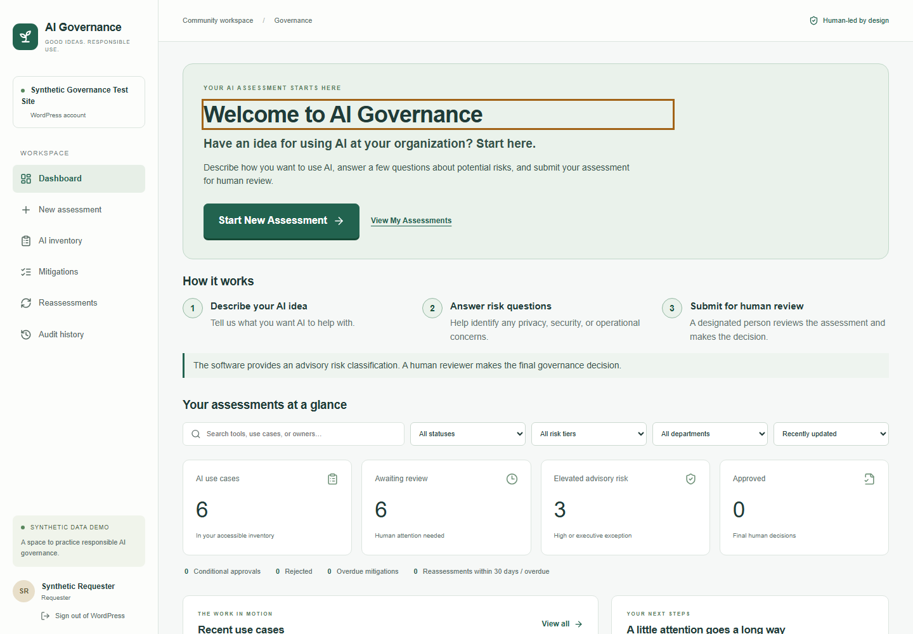
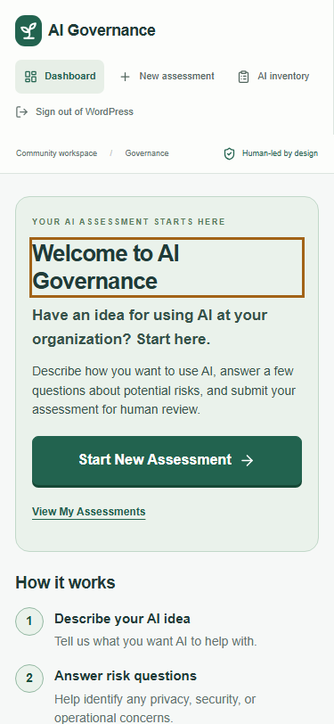

# WordPress Plugin Version — implementation and verification

**Version:** 3, an alternative to the existing Next.js/PostgreSQL and PHP/MySQL implementations.  
**Branch:** `feature/wordpress-plugin-version`.  
**Baseline:** tested Requester UX at `0f9cf2a`, including the dependency audit fixes.  
**Status:** implemented and locally verified on 2026-10-22; GitHub checks run separately for each implementation. No live site installation is claimed.

## Scope and architecture

The user requested a separate branch that packages the platform into a single WordPress plugin file and uses integrated WordPress credentials for access. The distributable is one PHP file, with the compiled React JavaScript, CSS, risk catalog, PHP domain functions, workflow functions, WordPress integration, and database adapter embedded at build time. An installable ZIP wraps that file in a plugin directory.

Repository source remains modular and reviewable. The build reuses `versions/php-mysql/app/domain.php`, `store.php`, and `workflow.php` under a separate namespace, plus the current shared React components. It replaces the standalone PHP session/demo-login adapter with WordPress authentication and replaces the database connection adapter with WordPress's existing `$wpdb` connection. The deterministic eight-factor classifier and governance workflow are not rewritten.

```text
WordPress account and authentication cookie
  → authenticated AI Governance app entry point
  → embedded React interface
  → WordPress REST route + X-WP-Nonce + live capability checks
  → shared validation, advisory risk and human workflow
  → WordPress database connection + prefixed InnoDB governance tables
```

The WordPress host needs no Node process, external asset CDN, separate application password, or PostgreSQL service. The plugin does not extract executable files or evaluate downloaded PHP at runtime. No existing WordPress content, PHP/MySQL app records, or earlier implementation is migrated or replaced.

## Authentication and authorization boundary

WordPress remains responsible for sign-in, password verification, account sessions, and site-level authentication extensions. The browser sends the WordPress REST nonce through `X-WP-Nonce` with its normal same-origin cookies. WordPress describes this as its cookie-authenticated REST flow; a nonce does not replace permission checks. [WordPress REST authentication](https://developer.wordpress.org/rest-api/using-the-rest-api/authentication/)

The plugin resolves the current authenticated WordPress user on the server, maps live governance capabilities into the existing role model, and then applies ownership, visibility, assignment, and state-transition checks. It does not accept the requester's claimed actor ID or a selected demonstration role as authorization. An unprivileged WordPress account must not gain access merely by obtaining a nonce. [Checking WordPress capabilities](https://developer.wordpress.org/plugins/security/checking-user-capabilities/)

| Capability | Existing governance role |
| --- | --- |
| `aigwp_request` | `REQUESTER` |
| `aigwp_review` | `REVIEWER` |
| `aigwp_admin` | `ADMINISTRATOR` |
| `aigwp_audit` | `AUDITOR` |

Activation registers dedicated requester, reviewer, and auditor roles. The existing WordPress Administrator role receives the governance capabilities required for administration. Other built-in roles do not automatically gain access. Role assignment uses WordPress's user administration; the app itself provides no role elevation or account impersonation endpoint. Capability changes must be reflected on subsequent requests, including revocation of an assigned reviewer's capability.

An account may have more than one capability. That does not weaken the rule that the requester cannot approve their own assessment. An administrator who is not the assigned independent reviewer cannot bypass the decision workflow. First use requires deliberate reviewer routing; the plugin must not seed synthetic login credentials or create public participant accounts during activation.

## Storage and preserved governance safeguards

The plugin's tables use `$wpdb->prefix` and a distinct `aigwp_` prefix, keeping them separate from ordinary WordPress tables and the other platform versions. InnoDB is required for the existing organization lock, transaction rollback, and serialized audit-chain writes. The WordPress database account must be permitted to create these tables. Activation is idempotent and retains existing records, policy versions, and audit-key material. WordPress's activation hooks provide the installation entry point for this setup. [Plugin activation hooks](https://developer.wordpress.org/plugins/plugin-basics/activation-deactivation-hooks/), [plugin database tables](https://developer.wordpress.org/plugins/creating-tables-with-plugins/)

The existing rules remain in effect:

- Eight deterministic risk factors with mandatory escalation and an explainable advisory tier.
- No automatic governance approval; only an assigned independent human may decide.
- Required rationale and mitigation for conditional approval.
- Server-side intake validation and revision checks against stale writes.
- Historical assessment and decision snapshots, policy versions, and audit events.
- Existing requester, reviewer, administrator, and auditor record-visibility boundaries.

A random, persistent audit key is stored as a WordPress option rather than derived from salts that an administrator might rotate. The database backup must include that option. WordPress identity mapping is stable for existing users; historical payloads retain the recorded names and IDs without treating a historic role snapshot as current authorization.

Deactivation or deletion of the plugin file retains governance tables and options. Data erasure is intentionally separate from disabling code. A backup, retention decision, and explicit removal procedure are needed before permanent deletion. There is no automatic migration from Versions 1 or 2.

Activation refuses to replace missing identity or audit-key options when an organization already exists. Restore the original options from backup instead. The regression suite removes each option in turn, verifies rejection without regeneration, restores it in `finally`, and verifies the audit chain. Initial policy creation is audited, and reactivation leaves policy/history/key unchanged.

## User experience and packaging

The interface retains the UAT-driven prominent **Start New Assessment**, concise process guidance, step progress, associated field errors, final review summary, draft/submission distinction, and confirmation based on persisted state. Role-specific starting actions and existing inventory, human review, evidence, mitigation, reassessment, configuration, and history views remain accessible according to permissions.

WordPress-specific presentation identifies the actual site and current account. Signing out uses WordPress logout; it does not switch to a synthetic identity. The standalone authenticated app page isolates the app's layout from a theme's public pages. No public shortcode or public application page is introduced in this version.

Source and output responsibilities:

| Location | Responsibility |
| --- | --- |
| `versions/wordpress/src/` | WordPress lifecycle, database, identity and REST integration |
| `versions/wordpress/frontend/` | WordPress request/navigation adapter around shared React screens |
| `versions/wordpress/build.mjs` | Build the catalog/assets and assemble the single PHP file and installable ZIP |
| `versions/wordpress/tests/` | WordPress-specific authentication, authorization and workflow verification |
| `versions/wordpress/README.md` | Installation, roles, first-run routing, upgrade and limitation guidance |

The generated files are `versions/wordpress/dist/ai-governance-wordpress.php`, `ai-governance-wordpress.zip`, and `SHA256SUMS`. The ZIP contains exactly `ai-governance/ai-governance-wordpress.php`. Only that generated plugin file belongs on the target host. Development source, `.local` fixtures, credentials, WordPress test configuration, and package dependencies are excluded from the release. The ZIP contents and plugin checksum should be verified during packaging.

## Verification plan and actual results

Verification must use a real isolated WordPress installation and synthetic accounts. Stubbed WordPress functions alone cannot establish that cookie authentication, REST nonces, role assignment, activation, or the database adapter work in WordPress.

| Check | Result | Evidence/command |
| --- | --- | --- |
| Single-file generation and ZIP contents | Passed locally | `node versions/wordpress/build.mjs`; archive has exactly one entry whose SHA256 equals the PHP file |
| PHP syntax | Passed locally | `php -l` on the generated plugin and every WordPress source/test PHP file |
| TypeScript and lint | Passed locally | `pnpm typecheck` / `pnpm lint` |
| Existing unit regressions | 49 passed locally | `pnpm test` |
| Real WordPress activation, identity, recovery and governance integration | 33 passed locally and on PHP 8.3/MySQL 8 in GitHub Actions | WP-CLI `eval-file versions/wordpress/tests/integration.php --use-include`; includes 320 classifier parity evaluations against the existing PHP algorithm |
| WordPress cookie login, nonce enforcement, role separation, full lifecycle, administration, mobile and keyboard | 8 passed locally | `pnpm exec playwright test --config versions/wordpress/playwright.config.ts` |
| Original production application build | Passed locally | `pnpm build` |
| Existing PHP/MySQL checks, static analysis and browser suite | Passed in GitHub Actions | 44 PHP checks, PHPStan, 23 browser tests, build and deployment packaging; [verified run](https://github.com/ctucker-web/ai-governance-capstone/actions/runs/39784275544) |
| Original PostgreSQL integration/browser and production pipeline | Passed in GitHub Actions | Unit/integration/browser tests, production build, dependency audit, container build and smoke test; [verified run](https://github.com/ctucker-web/ai-governance-capstone/actions/runs/39784742013) |
| Hosted WordPress installation | Not performed | No live site changes authorized as part of branch creation |

Required negative cases include unauthenticated reads/writes, missing or invalid nonce, a valid nonce without governance capabilities, actor/role spoofing, requester self-approval, administrator bypass of independent assignment, stale revisions, invalid intake, missing decision rationale, conditional approval without mitigation, and revoked capability access. Positive cases include first-run routing, persisted submission, a valid independent decision, evidence/mitigation/reassessment, unchanged older snapshots, and audit verification.

Local runtime: Windows, WordPress 7.1.3, WP-CLI 2.12.0, PHP 8.5.11, MariaDB 11.4.8, Chromium. The CI workflow pins WordPress 7.1.3 and WP-CLI 2.12.0 with checked download digests and uses PHP 8.3/MySQL 8.0. It installs the generated ZIP, runs the same tests, verifies reproducible packaging and publishes `WordPress-Plugin-Version` as a GitHub Actions artifact. Earlier WordPress releases, including the declared 6.6 minimum, have not been separately exercised.

The WordPress CI check on [PR #8](https://github.com/ctucker-web/ai-governance-capstone/pull/8) records the latest PHP 8.3/MySQL 8 results. Successful runs publish the release artifact. These are code and synthetic workflow checks, not a hosted deployment or human UAT result.

During verification, a local test configuration warning prevented cookie headers, and the synthetic administrator fixture initially handled an existing account password incorrectly. Those fixture/setup problems were corrected. Browser tests also exposed an HTML-encoded logout URL, which is now decoded before passing to JavaScript, and a race with WordPress's delayed login autofocus; tests wait for the native focus before typing. These failures were not skipped. WP-CLI 2.12 emits an upstream PHP 8.5 deprecation warning locally; it does not prevent the checks from passing.

To reproduce against an isolated WordPress test installation with a database name ending in `_test`, activate the generated plugin, set an ephemeral `WP_TEST_PASSWORD` of at least 20 characters, and run:

```sh
wp --path=/path/to/test-wordpress eval-file versions/wordpress/tests/fixtures.php --use-include
wp --path=/path/to/test-wordpress eval-file versions/wordpress/tests/integration.php --use-include
WP_TEST_URL=http://localhost:3300 pnpm exec playwright test --config versions/wordpress/playwright.config.ts
```

Fixtures create only synthetic test accounts and disable outbound account mail within the fixture process. Never run them against a real site. The full reproducible environment is defined in `.github/workflows/wordpress.yml`.

Use WP-CLI's `--use-include` option so PHP 8.3 executes the test file directly with its strict-types declaration. The default eval wrapper failed in the first CI attempt; this runner correction preserves strict typing and every assertion. [WP-CLI eval-file options](https://developer.wordpress.org/cli/commands/eval-file/)

The WordPress CI uses the Ubuntu 24.04 runner's installed Chrome through Playwright's supported `chrome` channel and records its version. Local tests default to bundled Chromium. This avoids a stalled browser dependency-install step while retaining the same eight browser tests and assertions. Set `WP_BROWSER_CHANNEL=chrome` to reproduce that browser selection locally. [Runner software inventory](https://github.com/actions/runner-images/blob/main/images/ubuntu/Ubuntu2404-Readme.md), [Playwright browser channels](https://playwright.dev/docs/browsers#google-chrome--microsoft-edge)

Actual local application screenshots, using synthetic WordPress accounts:





## Limitations and operational follow-up

This first version supports a single WordPress site, not Multisite. It does not provide account provisioning, a public shortcode, notifications, confidential file upload, cross-version data import, an automatic migration service, or a complete operational hardening programme. Existing UI instructions continue to call for fictional assessment content during evaluation.

WordPress login protects entry, while the site's hosting, installed extensions, administrator accounts, backups, and authentication configuration remain part of the trust boundary. Users with database and audit-key access can forge application audit records; removing the chain tail cannot be reliably detected without an external retained checkpoint. This is not PostgreSQL-trigger immutability or a claim of regulatory compliance.

No new human UAT or full accessibility audit is claimed. After code review and staging installation, run the [existing follow-up protocol](../testing/UAT_UX_FOLLOWUP_PROTOCOL.md) using separate WordPress accounts instead of the synthetic identity picker, record that authentication difference, and retain the same fictional assessment scenario. Record independent versus assisted completion separately. The next human study remains necessary before claiming improved usability.
